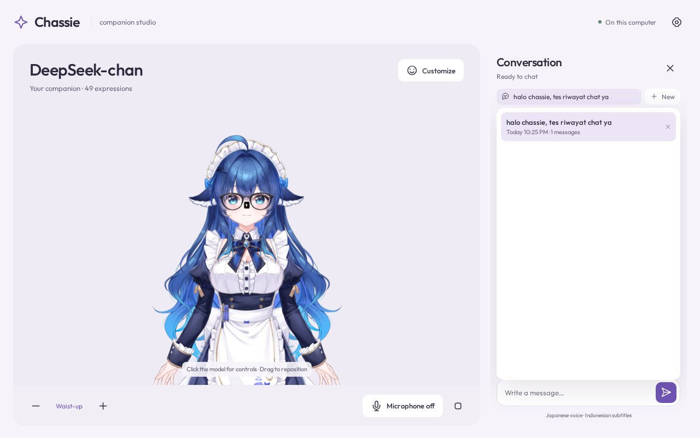

# Chassie

Companion desktop lokal dengan avatar Live2D: ngobrol lewat teks atau suara, menjawab dengan suara Jepang (VOICEVOX) dan subtitle Indonesia/Inggris, melihat lewat kamera dan layar saat perlu, dan mengingat hal penting di vault Obsidian. Otaknya adalah [Hermes](docs/hermes-setup.md) (Claude Haiku 5.5 lewat provider Anthropic); semua yang lain berjalan di komputer sendiri.



## Fitur

**Percakapan**
- Teks atau suara (faster-whisper + WebRTC VAD). Mode `review` menaruh hasil suara sebagai draft; `hands_free` langsung mengirim.
- Barge-in: mulai bicara saat Chassie bicara dan balasannya berhenti (perlu echo cancellation PipeWire).
- Balasan di-stream per kalimat: kalimat pertama langsung disintesis, subtitle mengikuti audio.
- Riwayat chat per sesi: membuka aplikasi melanjutkan chat terakhir, **History** membuka/menghapus sesi lama, dan setiap sesi yang ditinggalkan diringkas otomatis untuk diingat di chat berikutnya.
- Pengingat: "ingetin aku Sabtu jam 4 buat les gitar" membuat pengingat (bisa mingguan/harian) yang diucapkan Chassie saat waktunya dan kamu ada di depan kamera.
- Inisiatif: menyapa saat kamu kembali, mengomentari perubahan layar/kamera, atau memulai obrolan saat lama diam (mode normal/rare/off).

**Suara dan avatar**
- Satu gaya suara VOICEVOX (Mochiko-san Normal) dengan prosodi per kalimat: pitch, rentang intonasi, dan tempo mengikuti emosi dan bentuk kalimat (tanya naik, seru, "…" melambat).
- Lip-sync per suku kata dari timing mora VOICEVOX (a/i/u/e/o, bibir menutup pada m/b/p).
- 16 emosi dengan reaksi yang di-crossfade halus; emosi yang sering muncul punya beberapa variasi wajah.
- Gesture tangan dari motion bawaan model (DeepSeek-chan: telunjuk saat berpikir, tangan di dada saat malu/sayang, rumput ekor rubah saat iseng).
- Backchannel: mengangguk kecil di jeda saat kamu bicara.
- Tatapan kontekstual: menatap wajahmu (kamera), melirik ke panel chat saat kamu mengetik, ke atas saat berpikir, dan sesekali ke layar.
- Kursor: mengikuti mouse di dekat avatar, headpat saat kursor di kepala.

**Penglihatan dan memori**
- Kamera dan layar ditangkap lokal; gambar hanya dikirim saat diminta atau saat Hermes sendiri memutuskan perlu melihat (`{"action":"look"}`), supaya hemat token.
- Pengenalan wajah (YuNet + ArcFace) dan suara (WeSpeaker) lokal; orang lain di ruangan bisa disapa, dan mode tamu bisa menjeda memori pribadi.
- Memori di vault Obsidian bersama Hermes: Chassie memilih sendiri apa yang diingat, disimpan sebagai catatan rapi per kategori (`_generated/chassie/<Kategori>/<tanggal> <judul>.md`) dengan indeks `Memories.md`. Recall memakai FTS + embedding lokal (multilingual-e5-small).
- Refleksi harian: ringkasan dan "yang perlu ditanyakan lagi" ditulis ke `_generated/chassie-daily/`.

## Arsitektur

```
 mic ─▶ STT (faster-whisper, VAD) ─┐                ┌─▶ VOICEVOX worker ─▶ audio + lip-sync
 kamera / layar ─▶ visual_context ─┼─▶ orchestrator ─┤
 web UI / panel desktop ─ WebSocket┘   │    ▲        └─▶ avatar (Qt + live2d-py, dan web PIXI)
                                       ▼    │
                              hermes_bridge ─▶ Hermes gateway ─▶ Claude
                                                  └─ plugin memori (hermes_plugin/chassie) ─▶ vault Obsidian
```

| Bagian | Lokasi |
|---|---|
| Orkestrasi turn, sesi, pengingat, inisiatif | `orchestrator.py`, `chassie_core/` |
| Protokol balasan (pasangan JA + terjemahan, aksi, memori) | `bilingual.py`, `hermes_bridge.py` |
| Suara | `tts_engine.py`, `voicevox_tts.py`, `voicevox_worker.py`, `speech_prosody.py` |
| Avatar desktop (overlay transparan) | `desktop/` (`model.py`, `gestures.py`, `attention.py`, `motion.py`, `pointer.py`) |
| Katalog model dan reaksi | `avatar/` |
| Web studio | `ui/` |
| Plugin memori Hermes | `hermes_plugin/chassie/` |

## Persyaratan

- Linux (dikembangkan di CachyOS + Hyprland; overlay memakai XWayland), Python 3.12.
- [Hermes](docs/hermes-setup.md) berjalan lokal (`hermes-gateway` di `localhost:8642`) dengan provider Anthropic.
- Opsional: GPU NVIDIA (STT, embedding, deteksi objek); semuanya punya fallback CPU.
- PipeWire echo cancellation untuk barge-in (tanpa itu mic dijeda saat Chassie bicara).

## Instalasi

```bash
python3.12 -m venv .venv
.venv/bin/pip install -r requirements.txt -r requirements-overlay.txt

# Aset lokal (hash-checked):
.venv/bin/python scripts/install_voicevox.py      # suara (menerima ketentuan VOICEVOX)
.venv/bin/python scripts/install_vision.py        # deteksi + pengenalan wajah
.venv/bin/python scripts/install_speaker.py       # pengenalan suara
.venv/bin/python scripts/install_memory_model.py  # embedding memori

# Plugin memori untuk Hermes (symlink ke folder repo, folder lama dibackup):
scripts/install_hermes_plugin.sh
```

Lalu isi `vault_path` di `~/.hermes/chassie.json` dan simpan API key Hermes di `.chassie/hermes-api-key` (lihat [setup Hermes](docs/hermes-setup.md)).

**Model Live2D.** Tian Muzi (`model/Model_4`) ikut di repo. DeepSeek-chan tidak boleh diredistribusi: unduh sendiri, ekstrak ke `model/DeepSeek/` (folder ini di-gitignore), dan Chassie mendeteksinya otomatis.

## Menjalankan

```bash
.venv/bin/python launch.py          # backend + avatar desktop (atau buka "Chassie" dari menu aplikasi)
.venv/bin/python start.py --text    # backend + web studio saja
```

Web studio ada di `http://127.0.0.1:8000`. Di desktop, klik avatar untuk tombol chat, model, outfit, pengaturan, dan stop; seret untuk memindahkan; **Size −/+** di panel pengaturan mengubah ukuran jendela avatar. Shortcut menu: `install -Dm644 Chassie.desktop ~/.local/share/applications/chassie.desktop`.

## Konfigurasi utama (`config.yaml`)

| Kunci | Fungsi |
|---|---|
| `hermes.text_model`, `vision_model`, `reasoning_effort` | Model Claude yang dipakai Chassie (bukan default Hermes). |
| `conversation.input_mode` | `review` (draft) atau `hands_free`. |
| `conversation.barge_in` | Sela Chassie dengan suara (butuh AEC). |
| `tts.speed_scale`, `tts.lively_prosody` | Tempo dan variasi intonasi VOICEVOX. |
| `vision.camera_always` | `false` (default): model yang memutuskan kapan melihat kamera. |
| `vision.screen_always` | Kirim layar saat berubah dan ada aplikasi lain terbuka. |
| `initiative.mode` | `normal`, `rare`, atau `off`. |
| `companion.persona` | Kepribadian yang ditambahkan ke setiap balasan. |
| `companion.guest_privacy` | `true` untuk menjeda memori pribadi saat ada orang lain. |

## Data dan privasi

Semua data runtime ada di `.chassie/` (di-gitignore): `sessions/` (riwayat chat pemilik), `reminders.json`, `transcripts/` (bahan refleksi harian), `memory.sqlite` (template wajah/suara), dan pengaturan avatar. Riwayat, memori, dan pengingat hanya disimpan dalam scope personal (pemilik sendirian); percakapan dengan tamu tidak ditulis. Foto dan rekaman tidak pernah disimpan; yang dikirim ke Hermes hanya teks dan snapshot yang memang dilampirkan untuk turn itu.

## Pengembangan

```bash
.venv/bin/python -m pytest -q        # ~360 tes; tes browser memakai Playwright Chromium
QT_QPA_PLATFORM=xcb .venv/bin/python -m desktop.smoke --output .test-artifacts/overlay.png
```

Dokumen tambahan: [overlay desktop](docs/overlay.md), [penglihatan otomatis](docs/automatic-vision.md), [VOICEVOX](docs/voicevox.md), [setup Hermes](docs/hermes-setup.md).

## Lisensi aset

Kode di repo ini milik pemilik repo. Aset pihak ketiga mengikuti lisensinya masing-masing: model Live2D (Tian Muzi; DeepSeek-chan tidak disertakan), VOICEVOX (ketentuan runtime dan suara Mochiko-san ikut di bundle yang diunduh), WeSpeaker (CC BY 4.0), multilingual-e5-small (MIT), YuNet/ArcFace (lihat `scripts/install_vision.py`).
